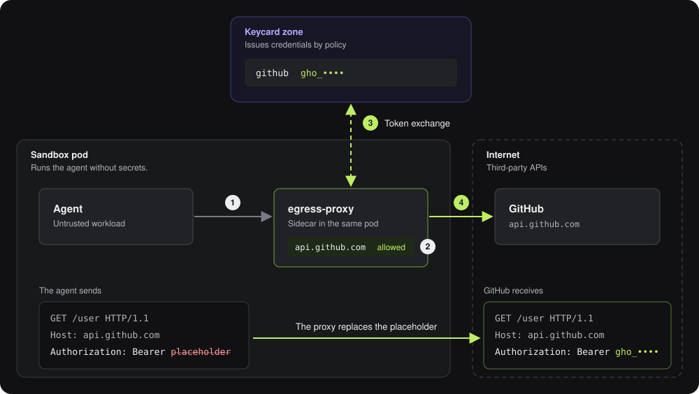

# egress-proxy

The Keycard egress proxy intercepts outbound network requests from an untrusted workload controlled by an agent.

It is a forward "man-in-the-middle" (MITM) proxy which terminates TLS and governs outbound connections with Keycard policy, which allows or denies target destinations and replaces placeholder credentials with actual bearer tokens, API keys or other real credentials transparently to the untrusted agent workload.

It proxies HTTP and HTTPS.

This service does not provide workload isolation "sandboxing". Rather, it is designed to be deployed as a component into such a configuration, as a means by which trust can be removed from untrustworthy workloads. See [https://github.com/keycardai/agent-sandbox-examples] for a reference example of such a deployment.

Here you'll also find supporting utilities which configure a self-signed CA for TLS termination, as well as network firewall rules for transparent proxying.

## How it works



The agent runs in a sandbox pod without secrets. The egress proxy runs
beside it as a sidecar. An init container installs iptables rules that send
the agent's outbound TCP to the proxy and drop everything else. The agent
trusts a CA that the proxy mints, so the proxy can read each HTTPS request.

When the agent calls the GitHub API:

1. The agent sends the request with a placeholder token, or none.
2. The proxy finds `api.github.com` in its endpoint list. It refuses any host
   the list doesn't name.
3. The proxy gets a GitHub token from the
   [Keycard zone](https://docs.keycard.ai/concepts/zones/) with an
   [RFC 8693](https://www.rfc-editor.org/rfc/rfc8693.html) token exchange
   [with impersonation](https://docs.keycard.ai/concepts/credentials/#impersonation).
   The pod's
   [ServiceAccount token](https://docs.keycard.ai/use-cases/agent-with-its-own-identity/#which-platforms-does-this-work-on)
   proves which agent is asking, and the zone's
   [policy](https://docs.keycard.ai/concepts/policies/) decides whether it
   gets one.
4. The proxy writes the token over the placeholder and sends the request to
   GitHub.

The agent never holds the GitHub token, and the token never appears in the
proxy's logs or audit records. The configuration document says where each
endpoint's credential goes:

```yaml
endpoints:
  - url: "https://api.github.com/"
    credential:
      placement: {kind: header, name: Authorization, template: "Bearer {credential}"}
  - url: "https://pypi.org/"   # allowed, no credential
```

A credential can also go in a query parameter, or in HTTP basic auth for git
over HTTPS.

## Run

    go build ./cmd/egress-proxy
    ./egress-proxy --config config.example.yaml --ca-out-dir ./shared-ca --admin /tmp/egress-admin.sock

Every flag also reads an `EGRESS_PROXY_*` variable, so a manifest can set the
per-instance values from the pod's own metadata and share one document.

The proxy listens for `CONNECT` on `127.0.0.1:3128` by default and writes its
CA certificate to the output directory. A client that trusts that certificate
and sets `HTTPS_PROXY=http://127.0.0.1:3128` reaches the endpoints the
document lists and nothing else:

    HTTPS_PROXY=http://127.0.0.1:3128 curl --cacert ./shared-ca/ca.crt https://pypi.org/simple/

Every decision is one JSON line on stdout. Logs are JSON on stderr. The admin
socket answers `/healthz`, `/readyz` and `/info`, and the binary itself dials
it, so a pod does not need a shell or curl to probe the proxy:

    ./egress-proxy --admin /tmp/egress-admin.sock probe info

`docs/configuration.md` describes every key of the document and every reason
code in the audit stream. `docs/containers.md` states what the containers
this repository ships need. `docs/security-model.md` states what the proxy
enforces and what it does not.

## Build

    make build      # the binaries
    make all        # build, test, lint, checks, acceptance
    make images     # the three images under images/, built locally

Go 1.27.1 or newer. The build-time tools are `tool` directives in `go.mod`,
built by the `go` command on first use. Nothing else needs installing.

## Contributing and security

`CONTRIBUTING.md` says how to report a bug or request a feature. `SECURITY.md`
says how to report a vulnerability. Never report one in a public issue.

## License

Apache-2.0. See `LICENSE` and, for third-party attributions, `NOTICE`.
The Keycard name and logo are trademarks; `TRADEMARKS.md` states how they may
be used.
